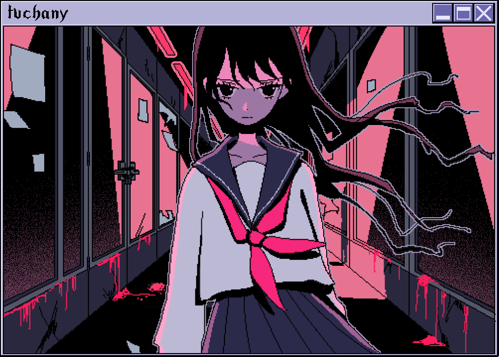
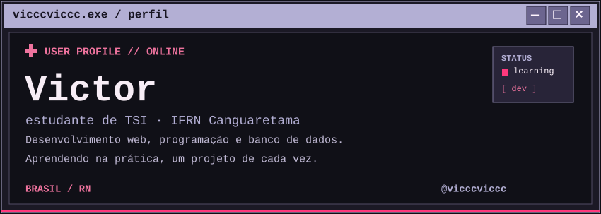

  
   
  

### Programming Languages

  
  
  

### Other Languages

  
  
  
  

### 🧰 Tools

  
  
  

  
    
  <a href="https://github.com/vicccviccc/ifrncangVRGP">IFRN / Extensão</a> ·
  <a href="https://github.com/vicccviccc/barracav2">Barraca do Baiano</a> ·
  <a href="https://github.com/vicccviccc/drawBD">drawBD</a>
    
  
  

---

  
<i>Nós nos atraímos. 
  Como uma gota d'água, como planetas. 
  Nós nos repelimos. 
  Como ímãs, como as cores da nossa pele.</i>

  
— Uryū Ishida

