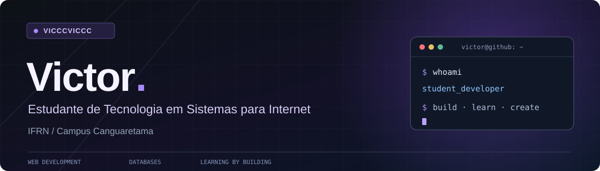
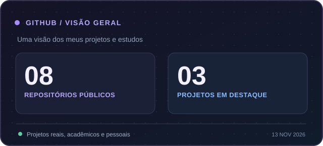
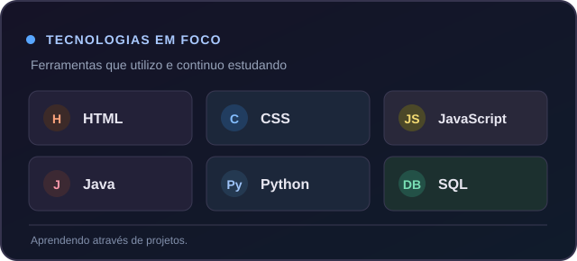

  

  
  

## Sobre mim

Olá! Eu sou o **Victor**, estudante do curso de **Tecnologia em Sistemas para Internet (TSI)** no **IFRN — Campus Canguaretama**.

Tenho interesse em desenvolvimento web, programação e banco de dados. Gosto de aprender construindo projetos e aprimorando o que já desenvolvi.

- **Atualmente:** estudando programação e desenvolvendo projetos acadêmicos e pessoais.
- **Na prática:** trabalhando com interfaces web, lógica de programação e modelagem de dados.
- **Objetivo:** evoluir como desenvolvedor a cada projeto.

## Linguagens e ferramentas

  &nbsp;
  &nbsp;
  &nbsp;
  &nbsp;
  &nbsp;
  &nbsp;
  &nbsp;
  

Ferramentas que uso ou estudo.

## Projetos em destaque

### <a href="https://github.com/vicccviccc/ifrncangVRGP">01 / Projetos de extensão — IFRN</a>

Site para apresentar projetos de extensão do IFRN Campus Canguaretama, valorizando os conteúdos, as fotografias e a identidade visual de cada iniciativa.

`HTML` `CSS` `JavaScript` · [Ver repositório](https://github.com/vicccviccc/ifrncangVRGP)

### <a href="https://github.com/vicccviccc/barracav2">02 / Barraca do Baiano</a>

Cardápio digital desenvolvido para uma lanchonete local, com montagem de pedidos, opções de pagamento e finalização pelo WhatsApp. Também é parte dos meus estudos no curso de TSI.

`HTML` `CSS` `JavaScript` · [Ver repositório](https://github.com/vicccviccc/barracav2)

### <a href="https://github.com/vicccviccc/drawBD">03 / drawBD</a>

Projeto acadêmico de banco de dados com foco na modelagem de um sistema de gestão de cemitério, incluindo regras de negócio e organização das entidades.

`Banco de dados` `Modelagem` · [Ver repositório](https://github.com/vicccviccc/drawBD)

## Atividade no GitHub

  

  

  Visão geral registrada em novembro de 2026. Para acompanhar as contribuições e os números mais recentes, <a href="https://github.com/vicccviccc?tab=overview">veja minha atividade no GitHub</a>.

---

  Um projeto de cada vez. Sempre aprendendo, sempre construindo. 
  <a href="https://github.com/vicccviccc">github.com/vicccviccc</a>

