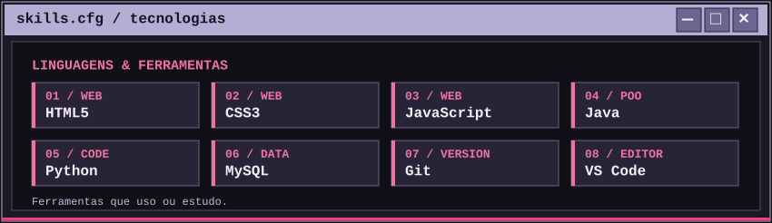

  <!-- banner: envie a imagem original para assets/anime-banner.png e descomente a linha abaixo -->
  <!--  -->
  
   
  
   
  
    
  
  
  
   
  
  
    

  

    <i>Nós nos atraímos. 
    Como uma gota d'água, como planetas. 
    Nós nos repelimos. 
    Como ímãs, como as cores da nossa pele.</i>
  

  
— Uryū Ishida

