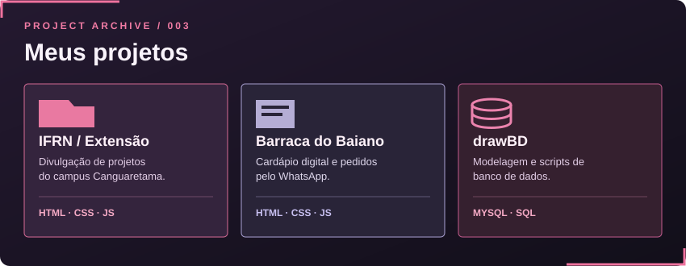

  
   
  

<h2 align="center">Tecnologias</h2>

<table>
  <tr>
    <td width="50%" valign="top" align="center">
      <b>Programação</b>  
      &nbsp; &nbsp;   
    </td>
    <td width="50%" valign="top" align="center">
      <b>Front-end</b>  
      &nbsp;   
    </td>
  </tr>
  <tr>
    <td valign="top" align="center">
      <b>Banco de dados</b>  
        
    </td>
    <td valign="top" align="center">
      <b>Ferramentas</b>  
      &nbsp; &nbsp; <picture><source media="(prefers-color-scheme: dark)" srcset="https://cdn.simpleicons.org/github/e9e0f1"></picture>  
    </td>
  </tr>
</table>

  
    
  <a href="https://github.com/vicccviccc/ifrncangVRGP">IFRN / Extensão</a> ·
  <a href="https://github.com/vicccviccc/barracav2">Barraca do Baiano</a> ·
  <a href="https://github.com/vicccviccc/drawBD">drawBD</a> ·
  <a href="https://github.com/vicccviccc/VDownload">VDownload</a>
    
  
  

---

  
<i>Nós nos atraímos. 
  Como uma gota d'água, como planetas. 
  Nós nos repelimos. 
  Como ímãs, como as cores da nossa pele.</i>

  
— Uryū Ishida

